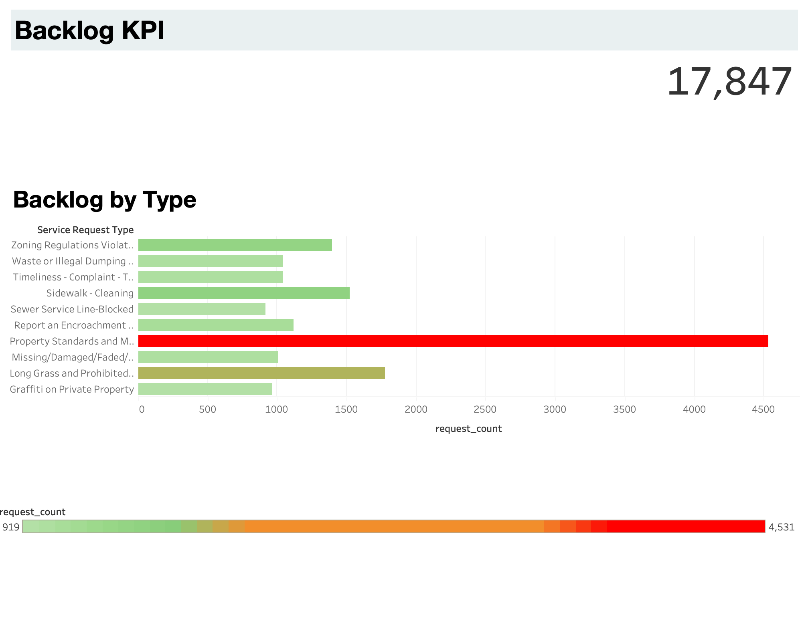

# Toronto 311 Service Request Audit

## 📌 Business Problem
The City of Toronto receives hundreds of thousands of 311 service requests annually. While city dashboards often report the raw volume of "active" requests, they rarely distinguish between **fresh intake** and **genuine backlog**. 
This project audits the 2026 311 dataset to answer: *Which request categories are genuinely stuck, and where are the data quality gaps?*

## 📈 Interactive Dashboard
I built an interactive Tableau dashboard to visualize the operational backlog and identify process bottlenecks across city divisions.

*[Insert your dashboard screenshot here. Example: ``]*

🔗 **[View the Interactive Dashboard on Tableau Public](INSERT_YOUR_TABLEAU_PUBLIC_LINK_HERE)**

## 🛠️ Tech Stack
- **Data Ingestion:** Python (`requests`, `ckanapi`, `pandas`, `zipfile`)
- **Database:** DuckDB (Embedded analytical database)
- **Analysis:** SQL (Common Table Expressions, Conditional Aggregation, Window Functions)
- **Visualization:** Tableau Public

## 📊 Key Insights (Based on 2026 Data)
1. **The "Open" Status is a Myth:** The dataset does not use an "Open" status. Active requests are tracked as `New` or `In Progress`. This means a naive dashboard querying `Status = 'Open'` would yield zero results.
2. **Nearly 50% of Active Requests are Backlogged:** Out of **35,920** active requests, **17,847** (49.6%) have been open for more than 90 days.
3. **The Chronic Failure (100% Backlog):** `Illegal Snow Dumping & Failure to Clear Snow or Ice on Public Sidewalk` has **347** active requests, and **100%** of them are older than 90 days. 
4. **The Highest Volume Backlog:** `Property Standards and Maintenance Violations` has the highest raw backlog volume (**1,674** requests aged >90 days).
5. **Process Bottlenecks:** Categories like `Graffiti on Private Property` (74.7%) and `Timeliness - Complaint - Toronto Water` (71.8%) show severe delays, indicating a systemic issue in routing or resolution for those specific divisions.

## 📂 Repository Structure
- `src/_311customersrequest/apis/profile.py`: Extracts the ZIP from the CKAN API, handles encoding, and profiles the raw data.
- `src/_311customersrequest/db/database.py`: Loads the cleaned data into a local DuckDB database.
- `queries/01_backlog_reconciliation.sql`: The core analytical query calculating active vs. aged backlog.
- `queries/02_dashboard_data.sql`: Aggregated data grouped into age buckets for Tableau visualization.
- `dashboard/`: Contains the Tableau workbook (`.twbx`) and dashboard screenshots.

## 🚀 How to Run
1. Clone the repo and install dependencies: 
   ```bash
   uv pip install pandas requests ckanapi duckdb

2. Fetch and load the data into DuckDB:
     ```bash
        python src/_311customersrequest/db/database.py
    ```

3. Run the audit query to see the backlog breakdown:

    ```bash 
        python src/_311customersrequest/db/runner.py
    ```

## 🧠 Data Caveats
- **"Today" is Oct 31, 2026:** The backlog age is calculated relative to the maximum `Creation Date` in the dataset, not the system date, ensuring reproducibility.
- **Data Quality:** There are 6,747 records with an `Unknown` status. These were excluded from the backlog analysis but represent a data-entry gap.


